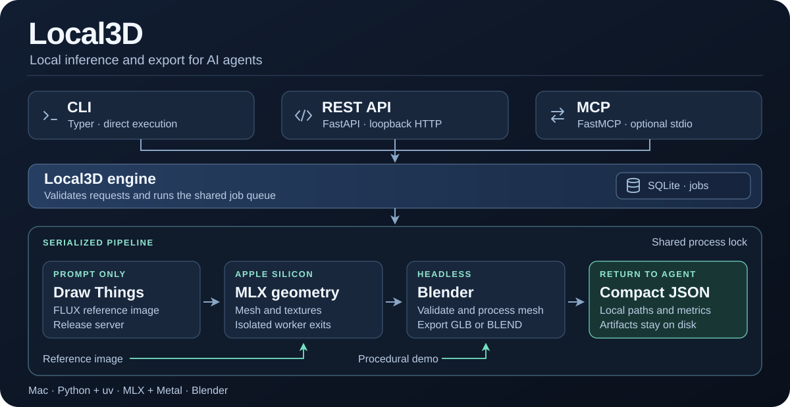

# Local3D

Local-first AI-powered 3D asset generation for coding agents. Optimized for Apple Silicon and compatible with Claude Code, Codex, and MCP-enabled agents.

Local3D turns a reference image into a textured mesh through a local provider and exports GLB or BLEND with headless Blender. Prompt-only generation can use an experimental Draw Things adapter. The CLI, REST API, and optional MCP server share a SQLite job store and return compact JSON with local paths.



[Mermaid source](docs/architecture.mmd) · [Model licenses](docs/model-licenses.md) · [Contributing](CONTRIBUTING.md)

## Quick start

Install [uv](https://docs.astral.sh/uv/getting-started/installation/), Git, and [Blender](https://www.blender.org/download/). Blender can live in `/Applications` or `~/Applications`. Use the official Blender 5.2 distribution. Set `LOCAL3D_BLENDER` if you install it elsewhere.

```sh
git clone https://github.com/crafter-station/local3d.git
cd local3d
uv sync --locked
uv run local3d setup
uv run local3d doctor
uv run local3d generate --provider demo --prompt torus
```

The demo is a procedural Blender smoke test. Read `asset.path` from the returned JSON to open the GLB. Use `--format blend` for an editable Blender file.

For model-based image-to-3D generation, accept the terms for the [official Stable Fast 3D checkpoint](https://huggingface.co/stabilityai/stable-fast-3d), then sign in locally with a read token that can access the gated model.

```sh
uvx --from huggingface-hub hf auth login
uv run local3d models install sf3d
uv run local3d generate --image /absolute/path/to/reference.png
```

Use a single, clearly framed object. PNG, JPEG and WebP inputs up to 25 MiB and 4096 × 4096 are accepted. Direct image input skips Draw Things. The job directory keeps the normalized reference, output and local log. Models, isolated Python environments, jobs and SQLite default to `~/Library/Application Support/Local3D`. Use `LOCAL3D_HOME` to choose another directory. Local3D surfaces provider failures in job metadata and returns a nonzero CLI exit status.

## Providers and hardware

| Provider | Role | Profile | Disk planning | Validation |
| --- | --- | --- | --- | --- |
| Blender | Import, optimize, preview and export | CPU preview on demand | Separate installed app | Headless GLB and BLEND workflow tested on Mac |
| Blender demo | Procedural pipeline smoke test | Cube, icosphere or torus | No weights | Tested end to end locally |
| Stable Fast 3D MLX | Single-image textured mesh | Fast default, 512 px bake. Explicit quality uses 1024 px | 4.02 GB checkpoint. Allow 8 GiB for runtime, caches and setup | Validated on M5 with official weights in fast and quality |
| TRELLIS.2 MLX | Single-image PBR mesh | Fast 512 without cascade, quality 768 cascade with a 12K token cap | Full upstream checkpoint repositories total 20.75 GB. Local3D fetches only the necessary files. Allow 24 GiB | Experimental. Metal and imports pass. DINOv3 access required |
| Draw Things with FLUX | Optional prompt-to-image stage | 512 px, 4 steps, tuned for FLUX.1 schnell | Managed by Draw Things. Size depends on model and quantization | Experimental |

| Hardware | Expected support |
| --- | --- |
| Apple M5 · 24 GB unified memory · macOS ARM64 | Primary development target. Blender 5.2.3 LTS and MLX Metal probed locally |
| Other Apple Silicon Macs with 24 GB or more | Candidate for image generation, subject to provider and scene complexity |
| Apple Silicon with 16 GB | Blender demo and post-processing are candidates. MLX geometry may run and can exceed available memory |
| Linux or Intel Mac | Blender and orchestration can run where dependencies are available. MLX model installation requires macOS ARM64 |

### Measured on Apple M5

Stable Fast 3D generated a textured chair from the [upstream reference image](https://github.com/bahaehmimdi/stable-fast-3d-mlx/blob/ac426cda2f50f5b31ed3818670ee2d426decee22/demo_files/examples/chair1.png) on a 24 GB M5 Mac with MLX 0.32.4 and Blender 5.2.3 LTS. Both outputs contained 20,072 triangles and one material.

| Run | Geometry | Blender | Peak geometry footprint |
| --- | ---: | ---: | ---: |
| Fast, GLB, first run | 21.3 s | 1.5 s | 6.05 GiB |
| SF3D quality, BLEND, second run | 13.0 s | 1.5 s | 6.31 GiB |

Install TRELLIS.2 after obtaining separate access to [Meta DINOv3](https://huggingface.co/facebook/dinov3-vitl16-pretrain-lvd1689m). Complex meshes can exceed the M5 target even with capped tokens and serialized stages. See the port's measured workloads and memory figures. [TRELLIS.2 MLX benchmarks](https://github.com/lyonsno/trellis2mlx/tree/449bfbc011401fe03d684a01f0b1068bfe8f6ceb#runtime-and-memory)

```sh
uv run local3d models install trellis2
uv run local3d generate --image /absolute/path/to/reference.png --mode quality --allow-experimental
```

### Prompt input with Draw Things

Install a FLUX.1 schnell checkpoint in Draw Things, disable Server Offload, and start its HTTP API bound to `127.0.0.1`. Check the model ID and API port in the app. The adapter uses `GET /sdapi/v1/options` and `POST /sdapi/v1/txt2img`. The upstream HTTP API exposes no model-unload route. [Draw Things server source](https://github.com/drawthingsai/draw-things-community/blob/main/Libraries/HTTPAPIServer/Sources/HTTPAPIServer.swift)

Configure a local release command that returns when the image process has released its resources. The included script quits a dedicated Draw Things app instance over macOS Automation and waits for the process to exit. Save any open projects before opting into that script. Restart the app and API before each prompt job when using it.

```sh
export LOCAL3D_DRAW_THINGS_URL=http://127.0.0.1:7860
export LOCAL3D_DRAW_THINGS_MODEL=flux_1_schnell_q5p.ckpt
export LOCAL3D_DRAW_THINGS_RELEASE_COMMAND="[\"$PWD/scripts/quit-draw-things.sh\"]"
uv run local3d generate --prompt "A red ceramic mug, isolated, three-quarter view" --allow-experimental
```

The Local3D lock holds through reference generation, release, 3D inference and Blender export. Geometry runs in an isolated process and exits before Blender starts. Log files hold the verbose provider output. On macOS, successful subprocess stages include peak RSS and peak process footprint when reported by `/usr/bin/time -l`. These are process measurements. Draw Things runs in its own application and its inference memory is outside this measurement.

## CLI

| Command | Purpose |
| --- | --- |
| `local3d generate` | Image or prompt to GLB or BLEND |
| `local3d doctor` | Blender, architecture, disk and provider availability |
| `local3d models list` / `local3d models install sf3d` | Check status and install pinned provider versions |
| `local3d jobs list` | Recent persisted jobs |
| `local3d optimize INPUT -o OUTPUT --ratio 0.5` | Decimate a static mesh into a new GLB or BLEND |
| `local3d preview INPUT -o preview.png` | Render a local PNG on request |
| `local3d export INPUT -o OUTPUT` | Convert between GLB and BLEND |
| `local3d serve` / `local3d mcp` | Loopback REST or optional stdio MCP |
| `local3d setup` | Initialize state and optionally prepare a macOS LaunchAgent |

## Agents

Link the same skill into both personal skill directories from the checkout root. Restart an agent session to discover the skill if needed.

```sh
mkdir -p "$HOME/.claude/skills" "$HOME/.agents/skills"
ln -s "$PWD/skills/local3d" "$HOME/.claude/skills/local3d"
ln -s "$PWD/skills/local3d" "$HOME/.agents/skills/local3d"
```

In Claude Code use `/local3d`. In Codex select or mention `$local3d`. Example request for either agent is “Generate a GLB from `/absolute/path/to/mug.png` and give me the resulting file path.” [Claude Code skills](https://code.claude.com/docs/en/skills) · [Codex skills](https://learn.chatgpt.com/docs/build-skills)

For optional MCP registration, provision the extra before registering the executable.

```sh
uv sync --locked --extra mcp
claude mcp add --scope user --transport stdio local3d -- "$PWD/.venv/bin/local3d" mcp
codex mcp add local3d -- "$PWD/.venv/bin/local3d" mcp
```

Call `generate_asset` with `{"request":{"image":"/absolute/path/to/reference.png"}}`, then poll `get_job` using the job ID. The MCP tools return status and paths. [Claude Code MCP](https://code.claude.com/docs/en/mcp) · [Codex MCP](https://learn.chatgpt.com/docs/extend/mcp?surface=cli)

## REST and launchd

```sh
uv run local3d serve
```

```sh
curl -s http://127.0.0.1:8765/v1/jobs \
  -H 'Content-Type: application/json' \
  -d '{"provider":"demo","prompt":"torus"}'
curl -s http://127.0.0.1:8765/v1/jobs/JOB_ID
```

`POST /v1/jobs` returns HTTP 202 with an ID. `GET /v1/jobs` lists jobs, `GET /v1/jobs/{id}` returns the result, and `GET /health` checks the endpoint. See `/openapi.json` for the schema. The service is intended for trusted same-user callers with access to local files. Keep the listener on loopback.

To run REST as a user-level macOS service, generate a LaunchAgent and load it in your login session.

```sh
uv run local3d setup --launchd
launchctl bootstrap "gui/$(id -u)" "$HOME/Library/LaunchAgents/com.crafterstation.local3d.plist"
```

Use `launchctl bootout` with the same domain and path to stop it. Keep the uv project virtual environment at the path recorded in the plist.

## Roadmap

- Publish reproducible image-to-3D benchmarks for both MLX providers across Apple Silicon memory tiers.
- Validate the local Draw Things start and release lifecycle across app versions.
- Add resumable checkpoints for TRELLIS.2 and measure conservative memory presets on 24 GB.
